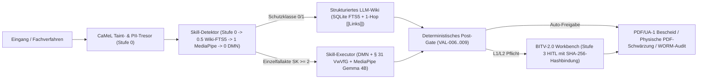

# Onboarding- & Nutzungshandbuch: JanusFlux (`v2.1.0+mp`)

Willkommen bei **JanusFlux (`verwaltung-genai-plattform-lightweight`)** – der Ultra-Lightweight-Verwaltungsplattform auf Basis von **Google MediaPipe (LiteRT)**, der **deklarativen Vier-Stufen-Skill-Engine** und dem **strukturierten SQLite-FTS5/BM25 LLM-Wiki**.

Dieses Handbuch führt **Plattform-Betreiber (DevOps/IT)**, **Fachadministratoren (Kommunen/Mandanten)**, **Wissensredakteure (Rechtsamt/Satzungen)** und **Sachbearbeiter (Workbench)** Schritt für Schritt durch das Onboarding und den täglichen Betrieb.

---

## Inhaltsverzeichnis

1. [Systemüberblick & Rollenmodell](#1-systemüberblick--rollenmodell)
2. [Schnellstart in 5 Minuten (Lokale Entwicklung & Edge-Betrieb)](#2-schnellstart-in-5-minuten-lokale-entwicklung--edge-betrieb)
3. [Onboarding einer neuen Kommune / eines Mandanten (`tenants/`)](#3-onboarding-einer-neuen-kommune--eines-mandanten-tenants)
4. [Pflege des strukturierten LLM-Wikis (`wiki/normen/` & `wiki/skills/`)](#4-pflege-des-strukturierten-llm-wikis-wikinormen--wikiskills)
5. [Erstellen & Registrieren eigener Verwaltungs-Skills (`skills/`)](#5-erstellen--registrieren-eigener-verwaltungs-skills-skills)
6. [Nutzung der 5 Referenz-Skills (Praxis-Rezepte & API-Beispiele)](#6-nutzung-der-5-referenz-skills-praxis-rezepte--api-beispiele)
7. [Arbeiten mit der BITV-2.0-Workbench & menschliche Freigabe (Stufe 3 / HITL)](#7-arbeiten-mit-der-bitv-20-workbench--menschliche-freigabe-stufe-3--hitl)
8. [Datenschutz, WORM-Audit-Prüfung & DSGVO-Crypto-Shredding (Art. 17 DSGVO)](#8-datenschutz-worm-audit-prüfung--dsgvo-crypto-shredding-art-17-dsgvo)
9. [Qualitätssicherung, Goldset-Kalibrierung & Release-Prüfung](#9-qualitätssicherung-goldset-kalibrierung--release-prüfung)
10. [Produktiv-Deployment mit Docker Compose & OPA](#10-produktiv-deployment-mit-docker-compose--opa)

---

## 1. Systemüberblick & Rollenmodell

JanusFlux trennt strikt zwischen deterministischer Regelprüfung, öffentlichem Satzungswissen und geschützten Einzelfallakten:



| Rolle | Typische Aufgaben in JanusFlux | Wichtige Verzeichnisse / Endpunkte |
|---|---|---|
| **IT-Betreiber / DevOps** | Bereitstellung, Modell-Integritätsprüfung (`sha256_manifest`), PostgreSQL-RLS, Token-Quotas | `deploy/compose/`, `models/*.yaml`, `janusflux serve` |
| **Mandanten-Admin** | Neue Kommune anlegen, erlaubte Skills & Schutzklassen freischalten | `tenants/<kommune>/tenant.yaml`, `janusflux onboard` |
| **Wissensredakteur (Rechtsamt)** | Satzungen, Gesetze und Dienstanweisungen (SK 0/1) als Markdown mit `[[Wiki-Links]]` pflegen | `wiki/normen/*.md`, `GET /api/v1/wiki/search` |
| **Skill-Entwickler** | Neue Verwaltungs-Skills deklarativ in YAML und DMN-Tabellen definieren | `skills/*/skill.yaml`, `rules/*.json`, `contracts/*.yaml` |
| **Sachbearbeiter** | Vorgänge in der BITV-2.0-Workbench sichten, Zwei-Sichten-PII-Vergleich prüfen, L1/L2-Freigaben erteilen | `GET /workbench`, `POST /api/v1/workbench/approvals/{id}/decide` |

---

## 2. Schnellstart in 5 Minuten (Lokale Entwicklung & Edge-Betrieb)

### Voraussetzungen
- **Python $\ge 3.11$** und **`uv`** (Paketmanager)
- Optional für Live-Datenbankbetrieb: **PostgreSQL 15/17** (ohne laufenden Postgres-Server nutzt JanusFlux automatisch den integrierten RLS-kompatiblen In-Memory-Modus für Entwicklung & Schnelltests)

### Schritt 1: Abhängigkeiten installieren & Umgebung prüfen
```bash
# Virtuelle Umgebung synchronisieren
uv sync --extra dev

# Architektur-, Typ- und Klartext-Log-Prüfung ausführen
make check

# Alle 57 Abnahmetests (LWP-01 bis LWP-18) ausführen
make test
```

### Schritt 2: Mandanten initialisieren (Onboarding)
```bash
uv run --no-sync janusflux onboard
```
Ausgabe:
```text
[ONBOARD-OK] 1 Mandant(en) erfolgreich eingerichtet: ['stadt-musterhausen']
```

### Schritt 3: Plattform & BITV-2.0 Web-Workbench starten
```bash
uv run --no-sync janusflux serve --host 0.0.0.0 --port 8000
```
- **BITV-2.0 Web-Workbench:** `http://localhost:8000/workbench` (bzw. `http://localhost:8000/`)
- **OpenAPI / Swagger-Dokumentation:** `http://localhost:8000/docs`
- **System-Healthcheck:** `http://localhost:8000/healthz`

---

## 3. Onboarding einer neuen Kommune / eines Mandanten (`tenants/`)

Jede Kommune wird deklarativ über eine eigene `tenant.yaml` im Verzeichnis `tenants/<mandanten-id>/tenant.yaml` verwaltet.

### Schritt 1: Mandanten-Konfiguration anlegen
Erstellen Sie z. B. `tenants/gemeinde-beispieltal/tenant.yaml`:

```yaml
tenant_id: gemeinde-beispieltal
name: "Gemeinde Beispieltal"
bundesland: "NW"
max_schutzklasse: 2
token_quota_monthly: 300000
allowed_skills:
  - dokument.schwaerzen
  - antrag.vorpruefen
  - dokument.extrahieren
  - auskunft.recht
  - eingang.routen
wiki_collections:
  - bundesrecht_vwvfg
  - satzungen_beispieltal
```

### Schritt 2: Onboarding-Befehl ausführen
```bash
uv run --no-sync janusflux onboard
```
Was dabei automatisch geschieht (`scripts/onboard_all_tenants.py`):
1. Validierung der `tenant.yaml` gegen das Plattform-Schema.
2. Prüfung, dass alle in `allowed_skills` genannten Skills in `skills/*/skill.yaml` existieren und den Ketten-Linter bestehen.
3. Anlage/Aktualisierung des Mandanten in PostgreSQL unter `FORCE ROW LEVEL SECURITY` (`SET LOCAL ROLE app_runtime`, `app.current_tenant_id = 'gemeinde-beispieltal'`) sowie Initialisierung des Zwei-Phasen-Token-Budgets (`TwoPhaseTokenQuotaManager`).

---

## 4. Pflege des strukturierten LLM-Wikis (`wiki/normen/` & `wiki/skills/`)

Das strukturierte LLM-Wiki ersetzt schwere Vektordatenbanken (Qdrant) durch **versionierbare Markdown-Dateien mit YAML-Frontmatter**, **expliziten `[[Wiki-Links]]`** und **lokaler SQLite-FTS5/BM25-Suche**.

> **Wichtige Sicherheitsregel (Harte Einzelfallakten-Schranke):**
> Das LLM-Wiki darf **ausschließlich** für allgemeines Wissen, Gesetze, Satzungen und Dienstanweisungen der **Schutzklassen 0 und 1** verwendet werden. Sobald ein Dokument `schutzklasse: 2` (oder höher) besitzt oder personenbezogene Daten (Namen, IBAN, Steuer-ID, E-Mail) enthält, verweigert `LLMWikiEngine` die Aufnahme sofort mit `WikiSecurityBoundaryError`.

### Beispiel: Eine neue kommunale Satzungsnorm anlegen
Erstellen Sie eine Datei `wiki/normen/gebuehrensatzung_p5.md`:

```markdown
---
node_id: "norm:gebuehrensatzung_p5"
node_type: "norm"
norm_id: "§ 5 Gebührensatzung"
gesetz_kurz: "GebS-Musterhausen"
titel: "Gebührenermäßigung und Härtefallregelung"
schutzklasse: 1
gueltig_ab: "2025-01-01"
gueltig_bis: null
links:
  - "§ 4 Sondernutzungssatzung"
  - "§ 31 VwVfG"
---
(1) Auf Antrag kann die Sondernutzungsgebühr nach [[§ 4 Sondernutzungssatzung]] bei nachgewiesener gemeinnütziger Nutzung um bis zu 50 vom Hundert ermäßigt werden.
(2) Für die Fristberechnung des Antrags gilt [[§ 31 VwVfG]] entsprechend.
```

### Vorteile durch das Markdown-Format:
- **Automatischer 1-Hop-Normgraph:** Durch die Notation `[[§ 4 Sondernutzungssatzung]]` und `[[§ 31 VwVfG]]` lädt `LLMWikiEngine.search_norms(..., expand_1hop=True)` die verwiesenen Paragrafen bei einer Suchanfrage automatisch als Kontext mit.
- **Bi-temporale Stichtagsfilterung:** Über `gueltig_ab` und `gueltig_bis` werden aufgehobene Altfassungen stichtagsgenau herausgefiltert.
- **Wörtliche Zitatprüfung (`VAL-007`):** Die Klammern `[[...]]` werden für den `raw_text` automatisch bereinigt, sodass das deterministische Post-Gate jedes vom LLM erzeugte Zitat zeichengenau gegen den Originalwortlaut verifizieren kann.

---

## 5. Erstellen & Registrieren eigener Verwaltungs-Skills (`skills/`)

Jeder Skill besteht aus:
1. einer deklarativen Manifest-Datei `skills/<skill_id>/skill.yaml`,
2. einem korrespondierenden Wiki-Knoten `wiki/skills/<skill_name>.md` für das deterministische SQLite-FTS5-Routing.

###Die 3 eisernen Regeln des Skill-Ketten-Linters (`SkillChainLintError`)
Beim Start prüft `SkillRegistry.validate_skill_chain()` jedes Manifest auf drei Sicherheitsinvarianten:
1. **Stufe-2-Nachschaltung:** Auf jeden generativen LLM-Schritt (`stufe: 2`) **muss** ein deterministischer Verifikationsschritt (`stufe: 0`, z. B. `p3.verify_post_gate`) folgen.
2. **Stufe-3-Freigabepflicht:** Jeder Skill mit `wirkung: irreversible` **muss** einen menschlichen Freigabeschritt (`stufe: 3`, `p8.approve`) mit `level: L2` enthalten.
3. **Token- & Aufruf-Budget:** Ein Skill darf maximal `llm_aufrufe: 2` und `max_input_tokens: 3500` deklarieren (CPU/iGPU-Latenzschutz).

---

## 6. Nutzung der 5 Referenz-Skills (Praxis-Rezepte & API-Beispiele)

Über den zentralen Endpunkt `POST /api/v1/skills/dispatch` erkennt JanusFlux entweder automatisch den passenden Skill aus dem Freitext oder führt einen explizit übergebenen `explicit_skill_id` aus.

### Use Case A: Posteingangs-Klassifikation & Routing (`eingang.routen`)
Klassifiziert Posteingänge, erkennt Frist-/Eilfälle und routet deterministisch per DMN (`rules/eingang_routing.json`).

```bash
curl -s -X POST http://localhost:8000/api/v1/skills/dispatch \
  -H "Content-Type: application/json" \
  -d '{
    "tenant_id": "stadt-musterhausen",
    "schutzklasse": 2,
    "text": "Fristsache: Widerspruch gegen den Ablehnungsbescheid vom 02.11.2026",
    "payload": {
      "schreiben_text": "Hiermit lege ich fristwahrend Widerspruch gegen den Bescheid ein."
    }
  }'
```

### Use Case B: Antrags-Vollständigkeits- & Fristprüfung (`antrag.vorpruefen`)
Prüft Wohngeld-/Sozialanträge gegen Pflichtnachweise, berechnet die gesetzliche Nachreichfrist nach **§ 31 VwVfG** (inkl. Sonn-/Feiertagsverschiebung) und ordnet den Vorgang in den Korb `GRUEN`, `GELB` oder `ROT` ein.

```bash
curl -s -X POST http://localhost:8000/api/v1/skills/dispatch \
  -H "Content-Type: application/json" \
  -d '{
    "tenant_id": "stadt-musterhausen",
    "schutzklasse": 2,
    "text": "Wohngeldantrag auf Vollständigkeit prüfen.",
    "payload": {
      "antrag_formular": {"antragsteller": "Max Mustermann", "anschrift": "Hauptstr. 1"},
      "anlagen_texte": ["Einkommensnachweis vorhanden, Mietbescheinigung fehlt"],
      "ereignis_datum": "2026-11-01"
    }
  }'
```

### Use Case C: Gesetzes- & Satzungsauskunft über das LLM-Wiki (`auskunft.recht`)
Durchsucht das lokale SQLite-FTS5 LLM-Wiki inkl. 1-Hop-Normgraphen und prüft das Ergebnis im Post-Gate auf wörtliche Zitattreue (`VAL-007`).

```bash
curl -s -X POST http://localhost:8000/api/v1/skills/dispatch \
  -H "Content-Type: application/json" \
  -d '{
    "tenant_id": "stadt-musterhausen",
    "schutzklasse": 1,
    "text": "Bitte erstelle eine Satzungsauskunft zur Sondernutzungsgebühr.",
    "payload": {
      "fragestellung": "Wie werden Gebühren nach § 4 Sondernutzungssatzung erhoben?"
    }
  }'
```

### Use Case D: Strukturierte Dokumenten-Datenextraktion (`dokument.extrahieren`)
Extrahiert Beträge, Aktenzeichen und Daten aus Bescheiden/Rechnungen mit verpflichtendem Originalbeleg-Zitat.

```bash
curl -s -X POST http://localhost:8000/api/v1/skills/dispatch \
  -H "Content-Type: application/json" \
  -d '{
    "tenant_id": "stadt-musterhausen",
    "schutzklasse": 2,
    "text": "Bitte strukturierte Datenfelder und Beträge aus Rechnung extrahieren.",
    "payload": {
      "dokument_text": "Rechnung vom 10.11.2026 zum Aktenzeichen Az. 50 WG 104/26 über einen Zahlbetrag von 420,00 EUR."
    }
  }'
```

### Use Case E: IFG-/RIS-Dokumentenschwärzung mit HITL-Freigabe (`dokument.schwaerzen`)
Erkennt PII-Spans (Namen, IBAN, Steuer-ID) und pausiert vor der physischen PDF-Schwärzung auf Stufe 3 (`AWAITING_HUMAN_APPROVAL`).

```bash
curl -s -X POST http://localhost:8000/api/v1/skills/dispatch \
  -H "Content-Type: application/json" \
  -d '{
    "tenant_id": "stadt-musterhausen",
    "schutzklasse": 2,
    "text": "Bitte Stellungnahme für das Ratsinformationssystem schwärzen.",
    "payload": {
      "doc_id": "123e4567-e89b-12d3-a456-426614174000",
      "zweck": "ratsinfo_oeffentlich",
      "dokument_text": "Stellungnahme von Herrn Max Mustermann (IBAN DE89370400440532013000)."
    }
  }'
```

---

## 7. Arbeiten mit der BITV-2.0-Workbench & menschliche Freigabe (Stufe 3 / HITL)

Sobald ein Skill einen Schritt der **Stufe 3 (`p8.approve`)** erreicht oder wegen unterschrittener Konfidenz ($\hat{\lambda}_{\text{auto}} < 0.84$) bzw. CaMeL-Taint-Schutz (`R3_IRREVERSIBLE_ODER_TAINTED_WRITE_SCHUTZ`) an die Workbench verwiesen wird, erfolgt die Bearbeitung in drei Schritten:

1. **Vorgang in der Zwei-Sichten-Ansicht abrufen (`GET /api/v1/workbench/approvals/{approval_id}/view`):**
   - Zeigt dem berechtigten Sachbearbeiter sowohl die **pseudonymisierte KI-Sicht** (`[PERSON_1]`, `[IBAN_1]`) als auch die **entschlüsselte Klartext-Sicht** aus dem `RedactionVault` sowie den kryptographischen `payload_sha256`-Hash.
2. **Entscheidung mit Hash-Bindung absenden (`POST /api/v1/workbench/approvals/{approval_id}/decide`):**
   ```bash
   curl -s -X POST http://localhost:8000/api/v1/workbench/approvals/<APPROVAL_ID>/decide \
     -H "Content-Type: application/json" \
     -d '{
       "decision": "APPROVED",
       "reviewer_id": "sachbearbeiterin-mueller",
       "expected_payload_sha256": "<PAYLOAD_SHA256_AUS_VIEW>",
       "begruendung": "Schwärzungsumfang nach § 4 IFG geprüft und freigegeben."
     }'
   ```
   > **Manipulationsschutz:** Stimmt `expected_payload_sha256` nicht exakt mit dem aktuellen Zustand des Vorgangs überein (etwa weil Daten im Hintergrund verändert wurden), lehnt die Plattform die Freigabe mit **`409 Conflict`** ab.

---

## 8. Datenschutz, WORM-Audit-Prüfung & DSGVO-Crypto-Shredding (Art. 17 DSGVO)

Jede Ausführung schreibt verkettete SHA-256-Einträge in das **WORM-Audit-Log** (`audit_events`), ohne jemals Klartext-PII zu speichern. Personenbezüge werden nur mit einem mandanten- und subjektspezifischen Zufalls-Salt (`audit_subject_salts`) gehasht.

- **Integrität der gesamten Hashkette prüfen:**
  ```bash
  curl -s http://localhost:8000/api/v1/audit/stadt-musterhausen/verify
  ```
- **Recht auf Löschung (Art. 17 DSGVO) per Crypto-Shredding ausführen:**
  Löscht den Salt einer betroffenen Person (`subject_ref`), wodurch alle historischen Subjekt-Hashes kryptographisch unumkehrbar anonymisiert sind, während die **SHA-256-Hashkette des WORM-Audit-Logs zu 100 % intakt und prüfbar bleibt**:
  ```bash
  curl -s -X POST http://localhost:8000/api/v1/audit/stadt-musterhausen/crypto-shred \
    -H "Content-Type: application/json" \
    -d '{"subject_ref": "buerger-4711"}'
  ```

---

## 9. Qualitätssicherung, Goldset-Kalibrierung & Release-Prüfung

Vor jeder Produktivsetzung oder nach Änderungen an Skills, DMN-Regeln oder Wiki-Normen stehen folgende CLI-Kommandos bereit:

```bash
# 1. Architektur-Linter & Klartext-Log-Scanner
uv run --no-sync janusflux check

# 2. Synthetisches Goldset (50 Kalibrierungs- + 200 Testfälle, 0 % PII) & CRC-Messbericht erzeugen
uv run --no-sync janusflux evaluate

# 3. Vollständige Release-Prüfung inkl. SHA-256-Prüfsummen in RELEASE_MANIFEST.json
uv run --no-sync janusflux release-check
```

---

## 10. Produktiv-Deployment mit Docker Compose & OPA

Für den Betrieb auf kommunaler Edge-/Server-Hardware (ab 4 vCPU, 16 GB RAM, ohne GPU) liegt eine gehärtete Container-Konfiguration unter `deploy/compose/` bereit:

```bash
docker compose -f deploy/compose/docker-compose.lightweight.yaml up -d --build
```

Enthaltene Dienste:
1. **`postgres` (`postgres:17-alpine`):** Persistente Datenbank für Mandanten, `FORCE ROW LEVEL SECURITY`, Skill-Journale und WORM-Audit-Kette.
2. **`opa` (`openpolicyagent/opa`):** Policy-Engine mit den Regeln aus `deploy/opa/plattform_authz.rego`.
3. **`plattform-app` (`Dockerfile.lightweight`):** Non-Root-Container (`uid 10001`, `read_only: true`, `cap_drop: [ALL]`) mit FastAPI-Server, MediaPipe-Runtime, SQLite-FTS5-Wiki und `FairQueueWorker`.
